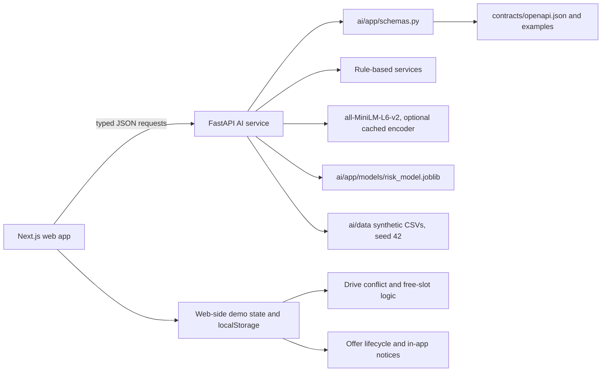

# CampusLink architecture

## Implemented today

`web/lib/ai/client.ts` is the typed browser client. Its base URL is `NEXT_PUBLIC_AI_BASE_URL`, defaulting to `http://localhost:8000`; generated TypeScript types come from `contracts/openapi.json`. The API shapes are defined by Pydantic models in `ai/app/schemas.py`; `contracts/` is generated from FastAPI and must not be edited by hand.

### Product flow and responsibility

| Stage | Implemented behavior | Owner of computation/state |
| --- | --- | --- |
| Profile | Student profile screens and demo profiles provide profile fields and assessments. | Web app; demo records are in `web/data/demo/`. |
| Readiness | `/ai/readiness` scores academic, skill, project, and assessment evidence. | AI service. |
| Matching | `/ai/skill-gap`, `/ai/parse-job`, `/ai/match`, and `/ai/rank` support skill gap analysis and recruiter fit. | AI service. |
| Scheduling | Placement Cell drive scheduler detects time-overlapping student, venue, and panel conflicts, checks the local academic calendar, and suggests free slots. | Web TypeScript logic and drive data; not an AI endpoint. |
| Notifications | Offer lifecycle notices are derived from local offer state and deadlines. | Web app and browser state; not an AI endpoint. |
| Offer tracking | Student and Placement Cell use offer list/detail/manage routes, a state machine, and localStorage key `campuslink.offers.v1`. | Web app localStorage demo store; not an AI endpoint. |
| Analytics | `/ai/analytics/summary` aggregates generated CSV records and optional risk-model counts. | AI service; summary is cached in memory and warmed during startup. |
| At-risk prediction | `/ai/predict-placement` predicts unplaced risk from profile and activity features. | AI service and trained scikit-learn artifact. |

The web app has four selectable internal roles: Student (`student`), Recruiter (`industry`), Placement Cell (`institution`), and Mentor (`faculty`, one at-risk screen). Alumni is not an active role. The shared role context is client-side and stores its selection in browser localStorage; this demo role switcher is not authorization. The AI API does not implement role authentication.

Offer lifecycle state is persisted in browser localStorage and offer notices derive from that web-side data. The scheduler also runs entirely in the web app, but its inspected drive/calendar logic uses local demo data and does not itself read or write localStorage.

### AI API and example calls

Requests use snake_case. Full request and response examples are in the generated files under [`contracts/examples`](../contracts/examples/).

| Endpoint | Example request |
| --- | --- |
| `GET /health` | `GET http://localhost:8000/health` |
| `POST /ai/readiness` | `{"student":{"student_id":"ST001","branch":"CSE","cgpa":8.2,"backlogs":0,"graduation_year":2027,"skills":["Python"],"projects":[]}}` |
| `POST /ai/skill-gap` | `{"student":{"student_id":"ST001","branch":"CSE","cgpa":8.2,"backlogs":0,"graduation_year":2027,"skills":["Python"],"projects":[]},"target":{"role":"Backend Developer","required_skills":["Python","SQL"],"preferred_skills":[]}}` |
| `POST /ai/parse-job` | `{"text":"Backend Developer. CSE/IT. CGPA 7+. Python and SQL required."}` |
| `POST /ai/match` | `{"student":{"student_id":"ST001","branch":"CSE","cgpa":8.2,"backlogs":0,"graduation_year":2027,"skills":["Python"],"projects":[]},"job":{"job_id":"JOB001","company":"Acme Tech","role":"Backend Developer","min_cgpa":7,"max_backlogs":0,"eligible_branches":["CSE","IT"],"required_skills":["Python"],"preferred_skills":[]}}` |
| `POST /ai/rank` | `{"job":{"job_id":"JOB001","role":"Backend Developer","min_cgpa":7,"eligible_branches":["CSE","IT"],"required_skills":["Python"]},"students":[{"student_id":"ST001","branch":"CSE","cgpa":8.2,"backlogs":0,"graduation_year":2027,"skills":["Python"],"projects":[]}]}` |
| `POST /ai/predict-placement` | `{"student":{"student_id":"ST104","branch":"CSE","cgpa":6.1,"backlogs":2,"graduation_year":2027,"skills":[],"projects":[]},"activity":{"drives_applied":6,"shortlisted":0,"interviews_attended":0,"rejections":6}}` |
| `GET /ai/analytics/summary` | `GET http://localhost:8000/ai/analytics/summary` |

Invalid input uses `{"error":{"code":"...","message":"...","field":"..."}}`. Analytics returns this error envelope with HTTP 503 if a required synthetic CSV is unavailable.

## Planned

- Persistent campus records, role-based authorization, and production identity are not part of the current local demo architecture.
- AI-assisted scheduling, notification delivery, and server-backed offer state are not implemented; those responsibilities currently stay in web-side logic and browser storage.
- Production hosting and horizontal scaling are described in [Scalability and deployment](SCALABILITY_AND_DEPLOYMENT.md).
